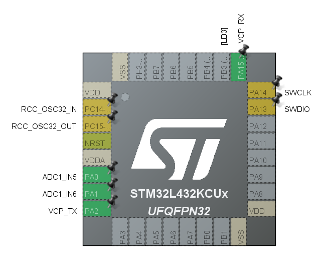

## M1 - ① ADC+DMA - Joystick (L432KC @ 48MHz) 검증
### 1. 검증 목적
KY-023 조이스틱 모듈의 2축 아날로그 신호를 STM32L432KC의 ADC1과 DMA로 안정적으로 수집하고, 이동평균 필터 적용 후 노이즈 특성이 M4 차동 구동 믹싱에 사용하기에 충분한 수준인지 확인하기 위함.

### 2. 시스템 개요
| 항목 | 내용 |
|-|-|
| 검증 항목 | M1 - ADC + DMA 조이스틱 입력 검증 |
| 날짜 | 2026-08-10 |
| 보드 | STM32 NUCLEO-L432KC (Cortex-M4F @ 48MHz / MSI) |
| 모듈 | KY-023 조이스틱 모듈 (10kΩ 포텐셔미터 × 2축) |
| 측정 장비 | ZOYI ZT102 디지털 멀티미터 |
| 개발 환경 | STM32CubeIDE 2.2.0 / STM32CubeMX / HAL |
| 펌웨어 파일 | [CAN-Failsafe-Node/M1/Src/JoystickTest.c](./Src/JoystickTest.c) |

### 3. 핀 배선
KY-023 모듈은 10kΩ 포텐셔미터 2개와 푸시 스위치로 구성됨. 모듈 표기가 "+5V"더라도 3.3V에 연결해야 ADC 입력이 포화되지 않음. 이는 M1에서 VCC 실측값 3.321V로 확인함.

| KY-023핀 | L432KC핀 | 보드 라벨 | 주변 장치 | 비고 |
|-|-|-|-|-|
| VCC | CN4-14 | 3V3 | 전원 | 3.321V 실측 |
| GND | CN3-4 | GND | 접지 | 공통 접지 |
| VRX | PA0 | A0 | ADC1_IN5_CH5 | X축(좌우) |
| VRY | PA3 | A2 | ADC1_IN6_CH6 | Y축(전후) |



### 4. ADC 설정 
DMA Continuous Requests와 Circular 모드를 동시에 활성화해야 변환이 중단 없이 순환됨(둘 중 하나라도 빠지면 DMA 전송이 1회에서 멈춤). 또한 HAL_ADCEx_Calibration_Start()는 반드시 HAL_ADC_Start_DMA() 호출 이전, ADC가 꺼진 상태에서 실행해야 함.
(Calibration factor = 61)

| 파라미터 | 설정값 | 비고 |
|-|-|-|
| Clock Prescaler | ADC_CLOCK_SYNC_PCLK_DIV4 (12MHz) | 노이즈 마진 확보 |
| Resolution | ADC_RESOLUTION_12B | 0 - 4095 |
| Scan Conversion Mode | ADC_SCAN_ENABLE | 2 채널 순차 변환 |
| Continuous Conversion Mode | ENABLE | 자동 반복 |
| DMA Continuous Requests | ENABLE | 누락 시 1회만 반환 |
| Number of Conversion | 2 | Rank1 = CH5, Rank2 = CH6 |
| Sampling Time | 247.5 cycles | 소스 임피던스 ~5kΩ 대응 |
| DMA Mode | Circular / Half Word | 2 × uint16_t 순환 |
| Calibration | Single-Ended, Start_DMA 전 | factor = 61 |
| 이동평균 길이 | N = 8 | 10ms 주기 × 8 = 80ms |

### 5. 측정 방법

* 중립 노이즈

    * 조이스틱에서 손을 뗀 상태에서 1,000 샘플(1ms 간격)을 수집하여 min/max/avg/p-p를 산출함. 
    * 코드 내 adc_noise_report() 함수로 자동화함.
* 풀 스트로크

    * 각 축을 물리적으로 끝까지 밀고 100ms 주기 스트리밍 출력에서 최솟값 및 최댓값을 읽음.
* 축 독립성 (크로스토크)

    * 한 축을 끝까지 민 상태에서 반대 축 raw의 최솟값 및 최댓값을 관찰하고, max(|최댓값-중립|, |최솟값-중립|)으로 크로스토크 산출함.
* VCC 측정 

    * ZOYI ZT102 멀티미터로 KY-023 VCC 핀과 GND 핀 간 전압을 측정함.

### 6. 측정 결과 

| 항목 | 기준 | X축 실측 | Y축 실측 | 판정 |
|-|-|-|-|-|
| 중립 raw 노이즈(p-p) | < 20 LBS | 7 | 4 | O |
| MA 필터 후 노이즈(p-p) | < 5 LBS | 1 LBS | 1 LBS | O |
| 중립 raw offset(avg) | 2048 ± 200 | 2016 | 2007 | O |
| 풀 스트로크 최솟값 | < 300 | 0 | 0 | O |  
| 풀 스트로크 최댓값 | > 3800 | 4089 | 4092 | O |  
| 축 독립성 (크로스토크) | < 50 LBS | 6 LSB | 4 LSB | O |  

| 항목 | 기준 | 실측 | 판정 |
|-|-|-|-|
| VCC 실측 | 3.3 V | 3.321 V | O |

전 항목 합격함. MA 필터 적용 후 p-p가 1 LSB로 수렴, 크로스토크가 최대 6 LSB로 50 LSB 기준 대비 여유가 큼.

### 7. M4 설계 상수 도출 
본 측정에서 도출된 값은 M4 차동 구동 믹싱 구현 시 아래 상수로 직접 사용됨. 2048 하드코딩 시 중립에서 미세하게 움직이는 문제를 방지하기 위해 실측 중립값을 기준점으로 사용할 예정임.

| 상수명 | 값 | 산출 근거 |
|-|-|-|
| JOY_CENTER_X | 2016 | X축 중립 avg 실측값 |
| JOY_CENTER_Y | 2007 | Y축 중립 avg 실측값 |
| JOY_MIN | 0 | 양 축 풀 스트로크 최솟값 |
| JOY_MAX | 4092 |양 축 풀 스트로크 최댓값 중 작은 값 |
| JOY_DEADZONE | 328 | ±8% × 4092 = 327.4 (올림)|

```c
/* M4에서 그대로 가져다 쓸 상수 */
#define JOY_CENTER_X   2016
#define JOY_CENTER_Y   2007
#define JOY_MIN          0
#define JOY_MAX       4092    // 두 축 중 작은 값 기준
#define JOY_DEADZONE   328    // (+|-)8% * 4092 = 327 -> 328
```

### 8. 트러블 슈팅

| # | 분류 | 증상 | 원인 | 조치 |
|-|-|-|-|-|
| T-01 | 소프트웨어 | 터미널에 프로그램 시리얼 출력이 뜨지않음 | 터미널이 아닌 시리얼 콘솔에서 봐야함 | 시리얼 콘솔 연결 |
| T-02 | 소프트웨어 | X raw와 Y raw가 같은 값으로 움직임 | Rank 2 Channel 중복 지정 | CubeMX Rank2를 CH6로 지정 |
| T-03 | 소프트웨어 | 출력이 너무 빨라 읽을 수 없음 | 루프 조건 uint32_t 캐스팅 (항상 참이 됨) | int32_t 캐스팅으로 수정 |
| T-04 | 소프트웨어 | 부팅 메시지가 출력에 묻힘 | 스트리밍 시작 전 대기 없음 | adc_noise_report() 후 3초 HAL_Delay 추가 |

### 9. 결론 
M1 - ① ADC+DMA 조이스틱 검증의 전 항목이 합격 기준을 충족함. 이를 통해 MA 필터 후 노이즈가 1 LSB로 수렴하여 M4의 10ms InputTask에서 안정적인 제어 입력을 얻을 수 있음을 확인함.
