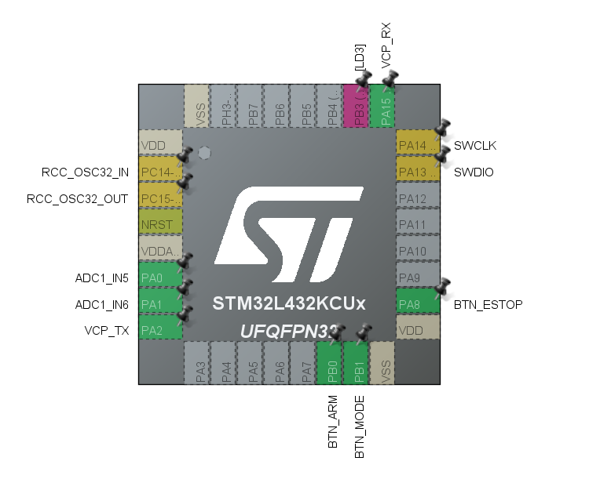

## M1 - ③ 버튼 EXTI + 디바운스 (L432KC @ 48MHz) 검증
### 1. 검증 목적
조종기 노드의 사용자 입력 3개(Arm/Mode/E-Stop)를 폴링이 아닌 EXTI 인터럽트로 받아들이고, 기계식 택트 스위치의 접점 채터링을 걸러내어 1번의 입력에 1번의 이벤트를 보장하는 것을 목표로 함. 버튼 입력은 CAN 메시지의 flags 필드와 mode 필드로 직결되므로 위 내용이 보장되지 않으면 치명적인 오동작이 발생함. 또한, FreeRTOS로 이관할 때 ISR은 InputTask에 이벤트를 넘기는 생산자가 됨. 이 시점에 ISR 실행 시간과 인터럽트 우선순위를 확정에 두지 않으면 RTOS 통합 단계에서 원인 추적이 어려워질 수 있음. 따라서 RTOS 없이 베어메탈 상태에서 입력 경로의 정확성을 먼저 수치로 확정하기로 함.

### 2. 시스템 개요
| 항목 | 내용 |
|-|-|
| 검증 항목 | M1 - 버튼 EXTI + 디바운스 입력 검증 |
| 날짜 | 2026-08-11 |
| 보드 | STM32 NUCLEO-L432KC (Cortex-M4F @ 48MHz / MSI) |
| 모듈 | 택트 스위치 × 3 |
| 개발 환경 | STM32CubeIDE 2.2.0 / STM32CubeMX / HAL |
| 펌웨어 파일 | [CAN-Failsafe-Node/M1/Src/ButtonTest.c](./Src/ButtonTest.c) |

### 3. 핀 배선

| 기능 | STM32 핀 | 보드 라벨 | 결선 | 내부 설정 |
|-|-|-|-|-|
| Button1 (Arm) | PB0 | D3 | 택트 SW 대각선 2핀 중 하나 -> PB0, 반대쪽 -> GND | Pull-up / Falling |
| Button2 (Mode) | PB1 | D6 | 동일 | 동일 |
| Button3 (E-Stop) | PA8 | D9 | 동일 | 동일 |
| Status LED | PB3 | D13 | 온보드 LD3, E-Stop 상태 표시 | Output PP |

버튼은 모두 활성 LOW(active-low) 결선임. 평상시 내부 풀업으로 HIGH를 유지하고, 누르면 GND로 떨어지므로 falling edge를 검출함. 별도의 외부 부품 없이 내부 풀업만 활용함.

### 4. 설정 
EXTI 세 라인은 서로 다른 NVIC 벡터를 사용함. PB0 → EXTI0_IRQn, PB1 → EXTI1_IRQn, PB8 → EXTI9_IRQn으로 분리되므로 세 버튼이 서로를 막지 않음. NVIC 선점 우선순위는 5로 통일함.

디바운스는 소프트웨어 2단 구조를 채택함. 1단은 HAL_GetTick() 기반 25ms 시간 잠금, 2단은 릴리즈 게이트임. 1단만으로는 T-02에서 확인된 릴리즈 바운스를 잡을 수 없었음.

| 파라미터 | 설정값 | 비고 |
|-|-|-|
| GPIO Mode | GPIO_MODE_IT_FALLING | active-low 결선, 누름 = HIGH → LOW |
| GPIO Pull | GPIO_PULLUP | 내부 풀업 약 30kΩ - 50kΩ |
| EXTI Line | PB0 → EXTI0 / PB1 → EXTI1 / PB8 → EXTI9_5 | 3개 독립 벡터, 상호 블로킹 없음 |
| NVIC Preemption Priority | 5(Sub 0) | M3 FreeRTOS 이관 대비 사전 확정 |

### 5. 측정 방법
ISR 진입 즉시 증가하는 원시 카운터를 두고 각 버튼 별로 20회씩 순차 입력 후 UART 로그로 출력된 이벤트 횟수와 원시 카운터 값을 비교함.

### 6. 측정 결과 

| 버튼 | 핀 | raw 엣지 | 확정 이벤트 | 필터링된 노이즈 |
|-|-|-|-|-|
| ARM | PB0 | 40 | 20 | 20(50.0%) |
| MODE | PB1 | 38 | 20 | 18(47.4%) |
| E-STOP | PA8 | 39 | 20 | 19(48.7%) |

세 버튼 모두 20회 입력에 대해 확정 이벤트 20건으로, 누락이나 중복 없이 정확하게 걸러냈음. 또한 각 버튼의 필터링 비율이 약 50%로 일관적임.

### 7. 트러블 슈팅

| # | 분류 | 증상 | 원인 | 조치 |
|-|-|-|-|-|
| T-01 | 소프트웨어 | 버튼을 눌러도 이벤트가 발생하지 않음 | ISR이 `s_btn_last`를 먼저 갱신한 뒤 레벨 재확인을 수행함. 접점이 튀어 재확인이 실패하면 25ms 창만 소모되고 반환됨. 접점 안정 후에는 추가 falling edge가 없어 이벤트가 영구 소실됨. | ISR 내 레벨 재확인 제거, 첫 엣지를 신뢰하는 leading-edge lookout 방식으로 번경. |
| T-02 | 소프트웨어 | 1회 누름이 2-3회 이벤트로 중복 등록 | 릴리즈 바운스가 누른 시점 + 25ms 범위 밖에서 발생하여 시간 필터를 통과함. | s_btn_down[] 릴리즈 게이트 도입. 핀이 25ms 연속 HIGH여야 다음 입력 허용함. |

두 트러블 모두 ISR 안에서 판단을 완결하려 했다는 동일한 설계 오류에서 파생됨. ISR은 엣지가 발생했다는 사실만 기록하고 유효성 판정은 시간이 있는 메인 루프로 넘기는 편이 안전함.

### 8. 결론 
3개 버튼 모두 20회 입력에 대해 20개의 이벤트가 발생함을 보장하였음. 필터 전 raw 엣지 대비 약 50%의 노이즈를 제거했으며 M1 ③의 완료 기준을 만족함.
